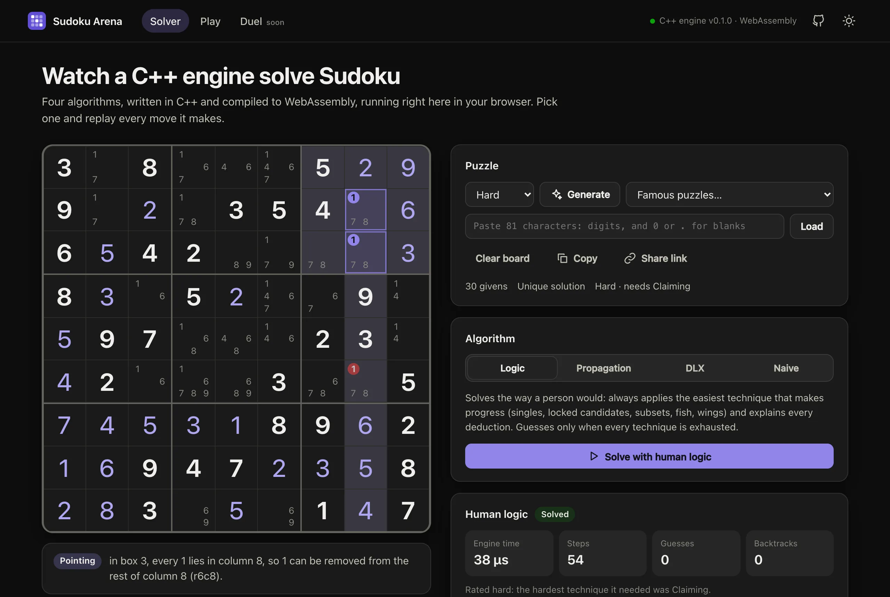
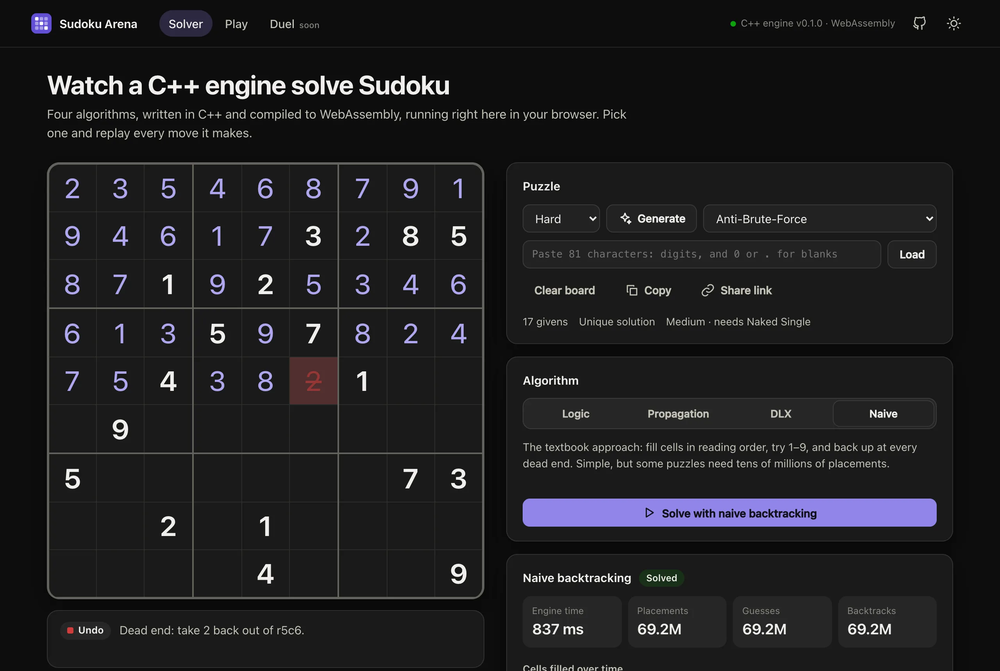
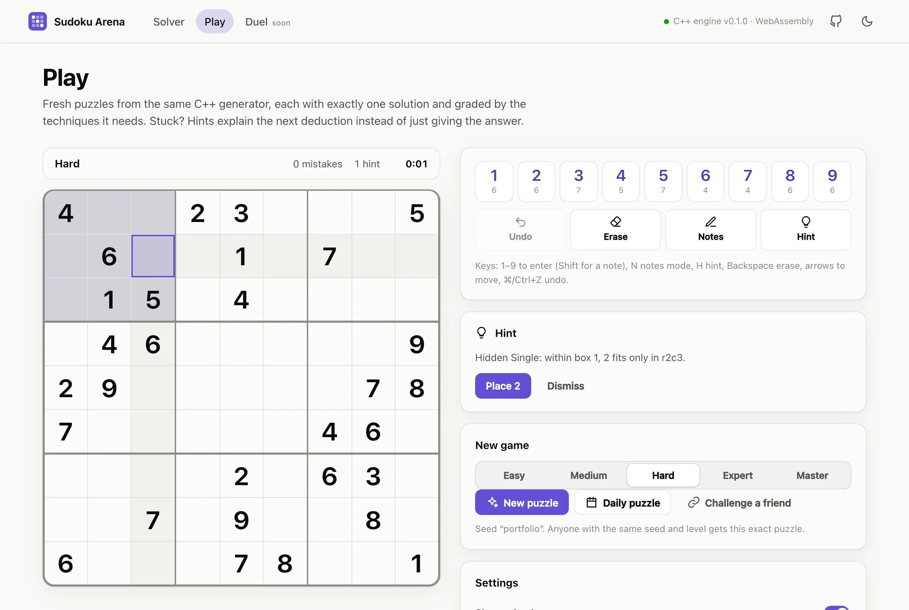
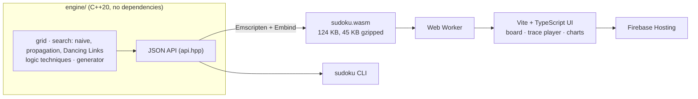

# Sudoku Arena

[](https://github.com/the-human-who-codes/sudoku-arena/actions/workflows/ci.yml)

**A Sudoku engine in modern C++, compiled to WebAssembly and visualised in the browser.**
Watch four solving algorithms work move by move, race them against each other, and play puzzles from a seeded generator. That generator is the groundwork for real-time 1v1 Sudoku duels.

**Live:** https://sudoku-arena-app.web.app



## Highlights

- **Four solvers, one C++20 engine.** Human-style logic with 15 techniques (Full House to XYZ-Wing), each deduction explained in plain English; constraint propagation with minimum-remaining-values branching; Knuth's Algorithm X with Dancing Links; and textbook naive backtracking.
- **Step-by-step replay.** Every solve returns a compact trace. The web app plays it forwards and backwards at 1 to 100,000 steps per second, shading the houses, patterns, placements and eliminations behind each move, and plots how full the grid is over time.
- **A generator that grades difficulty.** Symmetric puzzles with a unique solution, rated Easy to Master by the hardest technique a person needs. Its random numbers come from SplitMix64, so a seed gives the identical puzzle in every browser, the CLI and on a server. A golden test pins this on Clang/libc++, GCC/libstdc++ and WebAssembly.
- **Play mode:** notes, undo/redo, mistake tracking, hints that explain the next deduction instead of just revealing a digit, a daily puzzle, and challenge links (same puzzle, beat my time).
- **Tested end to end:** 66 GoogleTest cases, including a soundness check that no technique ever contradicts the solution across 180 generated puzzles, plus 19 Vitest cases that also exercise the real WebAssembly build. CI runs on every push.

| Naive backtracking needs 69,175,316 placements here | Play, with an explained hint |
| --- | --- |
|  |  |

## Architecture



- The engine is plain C++20 with no third-party dependencies (GoogleTest is fetched for tests only). A small string-in, JSON-out facade (`engine/include/sudoku/api.hpp`) is shared by the WebAssembly bindings and the CLI, so the browser and the terminal run identical code.
- In the browser the module runs in a Web Worker, so a one-second brute-force search never freezes the page. Search traces cross the worker boundary as transferable `Uint32Array`s, one packed event per placement.
- The UI is framework-free TypeScript. A `Trace` abstraction steps any solve forwards or backwards in time proportional to the cells that change, so scrubbing a 250,000-event replay stays smooth.

## The algorithms

| Algorithm | How it works |
| --- | --- |
| **Human logic** | Applies the easiest technique that makes progress: full house, hidden and naked singles, pointing and claiming, naked and hidden pairs, triples and quads, X-Wing, Swordfish, XY-Wing and XYZ-Wing. When none applies it guesses, and backtracks on contradiction. |
| **Constraint propagation** | Depth-first search that places every naked and hidden single before branching, and branches on the cell with the fewest candidates. Bitmask row, column and box occupancy keeps each step cheap. |
| **Dancing Links** | Knuth's Algorithm X on the 729-row × 324-column exact-cover matrix (cell, row-digit, column-digit, box-digit), with doubly linked lists so cover and uncover take constant time. |
| **Naive backtracking** | Fills cells in reading order, tries 1–9, backs up at dead ends. Included as the baseline. |

Average solve time, native release build on an Apple M3 Pro (`sudoku bench`):

| Puzzle | Dancing Links | Propagation | Human logic | Naive |
| --- | ---: | ---: | ---: | ---: |
| Classic (Wikipedia) | 11 µs | 1.0 µs | 16 µs | 32 µs |
| AI Escargot | 20 µs | 9.6 µs | 1.1 ms | 69 µs |
| Inkala 2012 | 207 µs | 114 µs | 756 µs | 375 µs |
| Easter Monster | 298 µs | 105 µs | 3.6 ms | 2.2 ms |
| Anti-brute-force (17 clues) | 13 µs | 2.9 µs | 24 µs | **572 ms** |

The last row is the classic demonstration of why heuristics matter. That puzzle is built so its top row solves to `987654321`, and naive backtracking needs 69,175,316 placements to get there, which matches the published figure. In the browser the same WebAssembly search takes about 0.9 s, while propagation needs a few microseconds.

### Difficulty levels

A puzzle's level is the hardest technique the logic solver needs:

| Level | Needs |
| --- | --- |
| Easy | singles only, with at least 36 givens |
| Medium | singles only, with fewer givens |
| Hard | locked candidates (pointing, claiming) or pairs |
| Expert | X-Wing, Swordfish, triples, quads, XY-Wing or XYZ-Wing |
| Master | more than any of those: trial and error |

The generator fills a random grid, removes clues in symmetric pairs while the solution stays unique and the rating stays at or below the target, and retries until the result rates exactly at the target. Every level generates in under 10 ms on average; the slowest cases take about 25 ms in the browser.

## Getting started

Prerequisites: CMake 3.21+, a C++20 compiler (tested with Apple Clang 21, GCC 13 in CI, and GCC 16), [Emscripten](https://emscripten.org/docs/getting_started/downloads.html) 6.0.12 for the WebAssembly build, and Node 22 (`mise.toml` pins it).

### Engine and CLI

```sh
cmake -S engine -B build/native
cmake --build build/native --parallel
ctest --test-dir build/native            # 66 tests

./build/native/sudoku solve "53..7....6..195....98....6.8...6...34..8.3..17...2...6.6....28....419..5....8..79" --algo logic --steps
./build/native/sudoku generate --level expert --seed 42 --count 3
./build/native/sudoku rate "1.......2.9.4...5...6...7...5.9.3.......7.......85..4.7.....6...3...9.8...2.....1"
./build/native/sudoku bench
```

### Web app

```sh
cd web
npm install
npm run engine    # compile the engine to WebAssembly (finds emsdk via $EMSDK or ~/.emsdk)
npm run dev       # http://localhost:5173
npm test          # game logic, replay, and the WebAssembly engine itself
npm run build     # engine + typecheck + production bundle in web/dist
```

### Deploying

`npm run deploy` (from `web/`) builds and deploys to Firebase Hosting, project `sudoku-arena-app`.

CI deploys every push to `main` once the `FIREBASE_SERVICE_ACCOUNT_SUDOKU_ARENA_APP` repository secret exists. Until then it skips the deploy step. Running `firebase init hosting:github` once creates that service account and secret.

## Project layout

```
engine/
  include/sudoku/   grid, search, logic, generator, api headers
  src/              solvers, techniques and explanations, generator, JSON API
  cli/              the sudoku command-line tool
  wasm/             Embind bindings
  tests/            GoogleTest suites
web/
  src/engine/       worker + typed client for the WebAssembly module
  src/player/       trace replay (forwards and backwards)
  src/game/         game model: entries, notes, undo, persistence
  src/ui/           board, charts, DOM helpers
  src/views/        Solver, Play, Duel pages
  tests/            Vitest suites
scripts/build-wasm.sh
firebase.json
```

## Roadmap: Sudoku Duel

The next step is real-time competitive play: two players, the same seeded puzzle, live.

- [x] Deterministic, seeded generator shared by every platform
- [x] Challenge links: same puzzle, beat my time
- [ ] Accounts with Firebase Authentication
- [ ] Rooms and matchmaking on Firebase Realtime Database, with opponents' progress shown as filled-cell counts, never digits
- [ ] Server-side move validation in Cloud Functions, reusing this engine's WebAssembly build under Node so clients never hold the solution
- [ ] Ratings, ladders and rematches

## License

[MIT](LICENSE)
